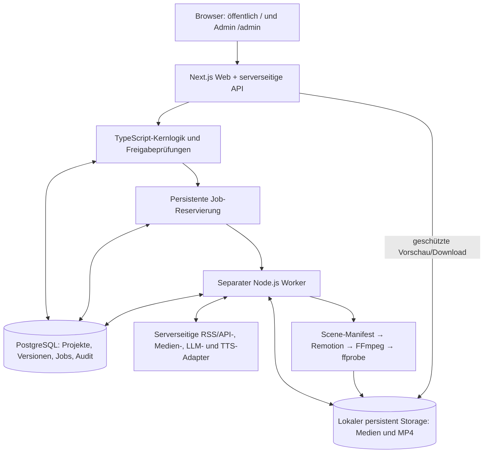

# Kernarchitektur und Systemgrenzen V0.1

**BlueDotAtlas · Roadmap 017 · vom Betreiber am 19.11.2026 (UTC) für die spätere Video-/Animationsproduktion freigegeben (DEC-033)**  
**Status:** Architekturentscheidung, **keine** implementierte/deployte Webapp oder freigegebene Produktions-Renderumgebung.  
**Grundlage:** [Master Roadmap V0.1](../project/BlueDotAtlas_Roadmap.pdf), S. 5–8 und 26; [PRD 010](../product/prd-v01.md); [VPS-Budget 012](../infra/vps-audit.md); [begrenzter FFmpeg-Proof 013](../infra/render-proof-013.md); [Rechte 014](../legal/rights-matrix.md), [Anbieter 015](../providers/vendor-registry.md), [Budget 016](../operations/budget-policy.md).

## 1. Grundentscheidung

**Ein modularer Monolith mit zwei eigenen Prozessen auf dem bestehenden VPS:**

- **Web/API:** eine Next.js-/React-/TypeScript-Anwendung für die öffentliche Videothek, den geschützten `/admin`-Bereich und serverseitige Node.js-/TypeScript-API-Routen.
- **Worker:** separater Node.js-/TypeScript-Prozess für längere Jobs (Import, Research, Medien, TTS, Render). **Kein lang laufender Render im HTTP-Request oder Browser.**
- **PostgreSQL:** zentrale persistente Quelle der Wahrheit für Projekte, Versionen, Freigaben, Claim-/Asset-Nachweise, Jobstatus und Audit. Kein kritischer Projektzustand nur im Browser oder in einer flüchtigen Queue.
- **Dateispeicher:** persistente, von vorhandenen VPS-Projekten getrennte lokale Verzeichnisse für Medien, Zwischenergebnisse und final validierte MP4s. PostgreSQL hält Referenzen/Metadaten, keine großen Videodateien.
- **Provider-Adapter:** ausschließlich serverseitige austauschbare Schnittstellen für RSS/API, wissenschaftliche Daten/Medien, LLM und TTS. Keine direkten Provider-Secrets oder kostenpflichtigen Aufrufe aus dem Browser.
- **Video-Pipeline:** typisierte Scene-/Manifest-Daten, geplantes Remotion für Szenenkomposition, FFmpeg für Export, ffprobe zur technischen Validierung. Die endgültige produktive Render-Eignung bleibt **offen**.

**Nicht vorgesehen:** Microservices-Landschaft, Kubernetes, zusätzlicher Pflicht-Cloudrenderdienst, Multiuser, vollwertiger Videoeditor, Autopublish oder kostenauslösende Provider ohne explizite Genehmigung.

## 2. Übersicht des Daten- und Kontrollflusses

**Fachliche Reihenfolge gemäß Aufgabe 017:** **Research → Script → Scenes → Media → Voice → Render**, mit bewussten Rückkopplungen und Freigabestopps. Die **sieben UI-Wizard-Schritte** werden nicht mit separaten Datenkopien verwechselt:

1. **New Video:** `VideoProject` mit Version/Status anlegen.
2. **News Sources:** global gepflegte RSS-/API-Quellen; Quellenstand beim Topic-Snapshot festhalten.
3. **Discover Topics / Research:** `TopicSnapshot`, `ResearchBrief`, `Claim`/`Evidence` mit Quelle, Datum und Unsicherheitsmarkierung.
4. **Media Library:** eine **erste** Mediensuche nach Topic vor dem Skript; Asset-Herkunft und Rechtestatus je Verwendung festhalten.
5. **Script Studio / Scenes:** freigegebene Claims → versioniertes Skript mit Narrationssegmenten und Visual-Intents; **zweite** passende Mediensuche pro Szene, wenn der Skriptbedarf klar ist. Scene Director entwickelt danach eine typisierte Timeline.
6. **Voice Studio:** freigegebener Sprechertext → TTS/Audioversion und **tatsächliche** Timing-Daten. Bei Änderungen nur betroffene Szenen-/Medienschritte neu prüfen.
7. **Video Production / Render:** aus **freigegebenen** Projektversionen, Narration, Rechtenachweisen und Medien ein unveränderliches Render-Manifest bilden; Worker rendert, ffprobe validiert, Admin prüft manuell. Erst eine **separate** spätere Publish-Aktion darf öffentlich sichtbar schalten.

**Sperren:** Ohne überprüfbaren wichtigen Claim oder mit `UNREVIEWED/BLOCKED/REJECTED`-Asset kein final freigegebener Film. Ohne ausreichenden Kostenrahmen/ausdrückliche Providerfreigabe kein kostenpflichtiger Job. Ein erfolgreicher Renderjob darf niemals selbst `published` setzen.

## 3. Modulgrenzen und Eigentümerschaft

Die unten genannten Pfade sind **Zielstruktur für M02**, nicht als bereits implementiert zu verstehen. Das vorhandene M00-`packages/ui` wird weiterverwendet.

| Modul / Zielpfad | Verantwortlich | Darf nicht |
| --- | --- | --- |
| `apps/web` | Next.js-Seiten, geschützter Einzeladmin, Request-Validation, Auth, schmale Server-API und Status-/Player-UI | Eigenständig FFmpeg/Remotion rendern, Secrets in Responses geben oder Rechte umgehen |
| `apps/worker` | Jobs reservieren, Status/Heartbeat/Timeout, begrenzte Retries, Medienabruf, TTS- und Renderprozesse überwachen | Web-Requests blockieren; abgeschlossene Jobs ohne validiertes Artefakt melden |
| `packages/core` | Fachmodelle, Zustandsübergänge, Freigabe-/Abhängigkeitsregeln, versionierte Manifest-Verträge und Kostenstopps | UI- oder Anbieterimplementierungen kennen |
| `packages/db` | PostgreSQL-/ORM-Zugriff, Migrationen, konsistente Transaktionen, Jobs und Audit | Businessentscheidungen stillschweigend ersetzen |
| `packages/providers` | RSS/API-, Media-, LLM-, TTS-Adapter; Nutzungs- und Kostenmetadaten; Rate-Limits | Als einzig erlaubter Provider fest verdrahtet sein; ungeklärte Rechte automatisch genehmigen |
| `packages/video` | Scene Director, Timeline und Komposition, FFmpeg-Exportprofil, ffprobe-Checks | Fremdmedienrechte oder Publish-Status stillschweigend freigeben |
| `packages/ui` | Bereits erarbeitete M00-Designtokens und wiederverwendbare UI-Elemente | Geschäftslogik oder Providerzugänge enthalten |

**Schnittstellenregel:** Browser → authentifizierte API → Fachlogik → Datenbank/Job; Worker bekommt **IDs und versionierte, überprüfte Inputs**, keine unauditierten Browser-Kommandos. Gemeinsame Typen/Schemas und Projektstatus gehören in `packages/core`. Beim Renderstart werden die konkreten Quell-/Skript-/Medien-/Voice-Versionen festgehalten; nachträgliche Änderungen invalidieren abhängige Freigaben.

## 4. Queue-Entscheidung und Ressourcen

**V0.1-Grundsatz: keine zusätzliche Redis-Instanz nur aus Gewohnheit.** Als **ressourcenschonender Startvorschlag** werden Jobdaten und Reservierungen über PostgreSQL modelliert (DB-Transaktionen, kurze Reservierung mit Lease/Heartbeat, anschließend Jobausführung außerhalb einer langen DB-Transaktion). Der einzelne Worker liest reservierbare Jobs, meldet Fortschritt und beendet/retryt kontrolliert. Ein `completed`-Status folgt erst nach gültigem Ergebnis.

**Redis/BullMQ bleibt eine ausdrücklich optionale Alternative** für [027 Jobqueue/Worker](https://github.com/whiteyOnTheMoon/BlueDotAtlas/issues/44), **nur** wenn die tatsächlichen Anforderungen, Betriebskosten und das Ressourcenbudget dies rechtfertigen. Das Design friert keine ungeprüfte Produktiv-Queue-Implementierung ein. **Keine produktive Renderparallelität durch Aufgabe 017 freigegeben.**

Konservative **Planungs**grenzen aus [012](../infra/vps-audit.md), vor tatsächlichem Deploy prüfen:

| Bereich | Obergrenze / Startbedingung |
| --- | --- |
| Bestehende VPS-Dienste | **Immer Vorrang**; bestehende Docker-Projekte, Datenbanken, Volumes, Ports und Tunnel nicht anfassen |
| Web/API | zunächst **384 MiB RAM**, **0,25 CPU** |
| Datenbank | isolierter BlueDotAtlas-Datenbereich und Zugang; **512 MiB RAM**, **0,25 CPU** als zusätzliche Planungsgrenze |
| Worker/Renderer | **max. 1024 MiB RAM geplant, zunächst deaktiviert**; keine ungetestete dauerhafte Renderlast oder parallelen Filmjobs |
| Startschutz | nach bisheriger Planung **mindestens 2 GiB MemAvailable** als Betriebsziel; bei Unterschreitung **keinen Render starten** |
| Speicher | lokale Budgettöpfe: **1G Web**, **4G DB inklusive WAL/Backups**, **20G Medien**, **12G Temp/Scratch**; Reserven für OS und andere Dienste unangetastet |

**Echte Messung 013:** Auf dem VPS bestand **ein einzelner synthetischer 8-Sekunden-FFmpeg-H.264/AAC-Encode** mit 1920×1080/30 FPS, **6,30 s Laufzeit**, ca. **224 MiB Peak-RSS** und 89G freiem Speicher laut gerundeter `df`-Anzeige. **Nicht bewiesen:** Remotion-Verhalten, lizenzgeprüftes Realfootage, Audio-/Medienintegration, Speicher-/CPU-I/O bei einem 55–65s-Film, 8–10-Minuten-Film, dauerhafter Workerbetrieb oder allgemeines VPS-Render-Go/No-Go. Vor produktivem Render/echtem Film müssen diese offenen Punkte bei M03 (035–048) bzw. der passenden technischen Integrationsaufgabe geprüft werden; die bereits abgenommene Aufgabe 013 bleibt abgeschlossen.

## 5. Deployment- und Sicherheitsgrenzen

- **Spätere Umsetzung in M02 (029):** eigene isolierte Compose-Projekt-/Netzwerknamen und Volumes für BlueDotAtlas; HTTPS über vorhandene Proxy-/Tunnel-Infrastruktur **nur nach Prüfung des aktuellen Routings**. Nicht fremde Compose-Stacks umbauen.
- PostgreSQL und eine mögliche Queue sind **nur intern** erreichbar, keine öffentlichen DB-/Redis-Ports. Der Webprozess hat eigene minimale Credentials; Admin-Auth serverseitig, sichere Sessions und durchgängige API-Berechtigungsprüfung.
- Dateiverzeichnis nach Roadmap bevorzugt **`/srv/blueDotAtlas`** in klar getrennten Bereichen `uploads/`, `cache/`, `temp/`, `rendered/`, `backups/`, `logs/`. Noch **keine Ordner/Volumes erstellt**. Ungültige relative Pfade und fremde Volumes dürfen nicht als BlueDotAtlas-Pfade akzeptiert werden.
- Provider-Keys nur serverseitig und aus freigegebener Konfiguration; keine Zugangsdaten im Git-Repository, Browser, Video-Metadaten oder Logs. API-Quoten und Kostenstopp orientieren sich an [016](../operations/budget-policy.md).
- Datenbank, Lizenz-/Quellennachweise, Manifest und fertige MP4s müssen im späteren Backup-Konzept (034) gemeinsam wiederherstellbar sein; Render-Tempdateien sind nicht als Backup zu betrachten.

## 6. Umsetzungsgates und offene Entscheidungen

| Roadmap | Hier festgelegt | Wird erst dort umgesetzt/getestet |
| --- | --- | --- |
| **017 (jetzt)** | Modulgrenzen, Datentransfer, Server-/Worker-Trennung, queue-sparsame Ausgangsstrategie, Rechte-/Kosten-Gates | **Nur Architekturreview**, kein Deploy/Render |
| **018–020** | Vorbereitete Issue-/PR-/Dokumentationsregeln | Repo-Workflow, Milestones, Definition of Done gemäß eigenem Issue |
| **021–026** | Workspaces, Web/API, Datenmodelle und Auth-Grenzen | Wiederholbarer Build/Migrationen, serverseitig getestete Rechte |
| **027–029** | Worker/Queue-Adapter, Storage, spätere Compose-/HTTPS-Isolierung | Job-Liveness, Restarts, Speicher-/Netzgrenzen, sichere Deploy-Tests |
| **030–034** | Secrets, CRUD, Autosave, CI, Restore | Nachgewiesene Sicherheit, Datenpersistenz und Wiederherstellung |
| **035–048 (M03)** | Prototyp eines echten wissenschaftlichen 60-Sekunden-Films mit lizenziertem Footage, Narration und Bewegung | Erst dann echter Film- und Produktions-Render-Gate |
| **049+** | Versionierter Scene Director / Langfilm / Providerworkflow | Echte Qualität, Kosten-/Lastprofile, Publisher-Gates |

**Offen und bewusst nicht in 017 „wegentschieden“:** konkrete ORM-/Queue-Bibliothek, Provider-Keys und TTS-Modell, PostgreSQL-Instanz/Schema im Detail, Reverse-Proxy-Routing, technische cgroup-Durchsetzung der Planungsbudgets, garantierter Renderdurchsatz und produktive Parallelität. **Der Startentscheid für eine PostgreSQL-basierte Queue ist ein Architekturvorschlag für M02, kein verdeckter Test- oder Dienstfreigabeersatz.**

## 7. Abnahme 017

- [x] Next.js/React, Node.js/TypeScript, PostgreSQL und getrennter Worker verortet.
- [x] Fachlicher Ablauf **Research → Script → Scenes → Media → Voice → Render**, inklusive zweiphasiger Mediensuche und sieben Wizard-Schritten, dokumentiert.
- [x] Grenzen der Module `apps/web`, `apps/worker`, `packages/core/db/providers/video/ui` beschrieben.
- [x] Ressourcen-, Kosten-, Rechte- und Publikationssperren gegenüber bestehender VPS-Infrastruktur klargestellt.
- [x] Kein unbewiesenes Redis/BullMQ-Erfordernis und keine falsche Remotion-/Realfilm-Renderfreigabe.
- [x] **Explizite Betreiberabnahme** erteilt am 19.11.2026 (UTC): „Wenn ich damit meine Videos und Animationen usw machen kann bin ich einverstanden“. Freigabe gilt **für die Zielarchitektur, die Videos, Animationen, Ton und Export ermöglichen soll**, nicht als technische Bestätigung einer schon funktionierenden Produktionspipeline. Entscheidung DEC-033; PR-Merge und Issue-Abschluss dokumentiert.
