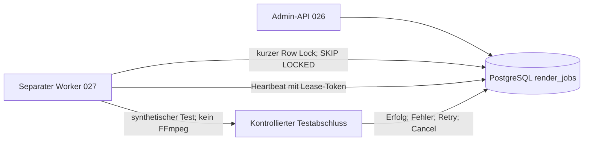

# Roadmap 027 – PostgreSQL-Queue und separater synthetischer Worker

**Status:** Umsetzung und CI-Prüfung im [PR #192](https://github.com/whiteyOnTheMoon/BlueDotAtlas/pull/192); **ADR-003 ist ein Vorschlag**, keine Betreiberabnahme. [Issue #44](https://github.com/whiteyOnTheMoon/BlueDotAtlas/issues/44). **Kein Livebetrieb, kein echter Video-Renderer.**

## Ziel und Architektur

Der Worker ist ein **getrennter Node.js-/TypeScript-Prozess** in `apps/worker`; Next.js speichert und liest ausschließlich bereits bekannte Jobzustände. Kein Langzeitprozess/FFmpeg-Lauf wird im HTTP-Request oder Browser gestartet. Der einzelne Worker verarbeitet genau einen Job zur Zeit; er verwendet das bestehende PostgreSQL 16 und benötigt **keine Redis- oder Cloud-Queue**.

Die **vorläufige** Architektur ist unter [ADR-003](../architecture/adr/003-postgresql-job-leases.md) mit Alternativen, Ressourcenfolgen und offenen Betriebsrisiken beschrieben. Bereits genehmigte [ADR-001](../architecture/adr/001-modular-monolith.md) und [ADR-002](../architecture/adr/002-single-admin-sessions.md) bleiben in Kraft.

## Jobmodell und Zustandsübergänge

Das bestehende Domain-Modell [024](data-model.md) definiert `queued`, `running`, `succeeded`, `failed` und `cancelled`, `attempt`, `max_attempts`, `lease_expires_at`, `manifest` und Audit-/Projektversionen. Die **inkrementelle** Drizzle-Migration `0003_colossal_dazzler.sql` ergänzt:

| Feld | Zweck |
| --- | --- |
| `lease_token` UUID nullable | Frische zufällige Fencing-Identität **je Reservierung**, nicht je Worker |
| `heartbeat_at` timestamptz nullable | Letzte aktive, erfolgreich geprüfte Lease-Verlängerung |
| `available_at` timestamptz NOT NULL DEFAULT now() | Früheste nächste fällige Reservierung nach Backoff |
| `render_jobs_dispatch_idx` | Ressourcenarme Suche nach fälligen Jobs |
| `render_jobs_lease_ownership_valid` | `running` erfordert Token+Leasetermin; jeder andere Status lässt beide NULL |

**Zustandsautomat:** `queued → running → succeeded` oder `queued → running → failed → queued` bei Retry. Bei abgelaufener Lease wird `running → failed` gesetzt; ein eigener Schritt setzt nach **mindestens 250 ms, exponentiell bis maximal 8 Sekunden**, erneut auf `queued`, **nur falls** `attempt < max_attempts`. `queued|running|failed → cancelled` ist sofort wirksam und verhindert späte Statusänderungen. `succeeded` und `cancelled` sind terminal; ein Statuswechsel nach `published` ist in dieser Aufgabe nicht implementiert.

**Sicherheitsgrenze für Konkurrenz:** `SELECT ... FOR UPDATE OF r SKIP LOCKED` hält den Row Lock nur während des kurzen Claims. Claim erhöht `attempt` atomar und erhält jedes Mal ein neues `lease_token`. Heartbeat, Fehler und Erfolg benötigen *gleichzeitig* `status='running'`, das aktive Lease-Token und `lease_expires_at > NOW()`. Der alte Worker kann nach Ablauf/Übernahme/Kündigung nichts mehr als `succeeded` markieren. Auch parallele zwei-Prozess-Claims beanspruchen denselben Job nie doppelt.

**Soft Delete:** Jobs von gelöschten Projektversionen oder Projekten werden nicht reserviert; abhängige Video-/API-Status werden nicht künstlich als veröffentlicht markiert. In der ersten Version werden nur Datensätze mit der fest erlaubten Manifestart `synthetic_027` für den Test reserviert.

## Strikt begrenzter Testexecutor

Dies ist **kein Produktionsworker**: `node apps/worker/dist/run.js` verweigert sich ohne **beide** Schalter `BDA_DB_TEST=1` und `BDA_WORKER_SYNTHETIC_TEST=1`; `DATABASE_URL` muss auf die **eigene** lokale PostgreSQL-Datenbank `/bda_test` an `localhost` oder `127.0.0.1` mit dem ausschließlich synthetischen Datenbankbenutzer `bda_test` und ohne URL-Query-/Fragment-Overrides zeigen. Der `run.js`-Test kann zusätzlich `BDA_WORKER_ONCE=1` setzen und endet nach höchstens einem reservierten Job. Es werden keinerlei unbekannte Befehle, Mediendateien oder Drittanbieter-Requests ausgeführt.

Ein expliziter Aufruf von `enqueueSyntheticJob` aus dem **isolierten** Testharness darf ausschließlich `{kind:'synthetic_027',durationMs,failUntilAttempt}` in `manifest` hinterlegen: Dauer 200–5000 Millisekunden, maximal drei Versuche, deterministische Fehlversuche. Eine öffentliche Web-Route zum Einreihen beliebiger Jobs gibt es in 027 **nicht**; der bestehende authentifizierte `GET /api/v1/jobs/:id` aus 026 zeigt den Zustand nur lesend.

**Zusätzliche Sicherheitsbedingungen vor echtem Render:** signierte/versionierte Read-only-Manifeststruktur, nachweislich lizenzierte/zugelassene Medien, klarer Kostenstopp, eindeutige idempotente Artefakt-IDs, ffprobe-Abnahme, CPU-/RAM-/Filesystem-Limits, Rollen-/Secret-/TLS-/Proxyprüfungen, Restore und sichere Shutdown-/Wartungsprozesse (029–030, 034 sowie spätere Rendering-Meilensteine). Ein synthetischer `succeeded`-Job ist **kein fertig gerendertes Video**.

## Reproduzierbare CI-Tests und Wiederanlauf

Der [dedizierte Worker-CI-Workflow](../../.github/workflows/worker-queue-check.yml) startet **ausschließlich** einen wegwerfbaren PostgreSQL-16-Service mit `/bda_test`, frozen pnpm 11, Unit-/Typ-/Lint-/Format-/Build-Checks und Drizzle `db:check`, `db:generate` mit Drift-Gate, Migration frisch und wiederholt. Er führt den PostgreSQL-Integrationstest `test:queue` aus: zwei konkurrierende Pool-Claims, Heartbeat, Lease-Ablauf, Fail-/Retry-Backoff, MaxAttempt, Cancel vor/während Ausführung, Token-Fencing und Filterung unbekannter Manifeste.

Anschließend prüft `node scripts/check-worker-027.mjs` mit echter Next.js-Production-Instanz und **separaten** Child-Prozessen: verweigerter Nichttestbetrieb, authentifizierte HTTP-GET-Liveness bei laufendem Job, synthetischer Erfolg, Fehler/Retry, Cancel ohne Late-Success, kooperativer SIGTERM mit Retry, echter SIGKILL mit Lease-Expiry/Recovery und Konkurrenz zweier Worker-Prozesse. Es wird keine produktive oder fremde Datenbank beschrieben, kein Docker-Dienst im Live-VPS gestartet und kein UI-Screenshot als synthetisches Renderergebnis ausgegeben.

**Rollback:** Aufgabe 027 führt **keine** produktive Migration aus; Drizzle `0003` ist additiv, alte `0000–0002`-Tabellen/Datensätze werden nicht gelöscht. Vor späterem Live-Deploy: exklusives Backup/Restore-Testfenster, Migrationstests auf Datenspiegel, eigenes Rollback-Runbook, Prüfung alter `running`-Daten vor dem neuen DB-Constraint und Freigabe des Betreibers. Es gibt **keinen** automatischen Produktiv-Rollback über ungetestete `DROP COLUMN`-Befehle.

## DoD und offene Gates

- CI-Unit-/Integrationstest und echte Prozess-/HTTP-Beweise müssen **auf dem finalen PR-Head** erfolgreich sein; ein grüner alter Commit reicht nicht.
- **UI-/Video-/Medien-Nachweise n/a:** Keine UI-Ansichten, Animationen, FFmpeg-Exports oder Drittmedien werden geändert. CI-Logs und SQL-/HTTP-Integrationsergebnisse sind die vorgesehenen Belege.
- Architekturentscheidung **ADR-003 Proposed**; explizite Betreiberfreigabe des konkreten PR #192 einschließlich ADR-003 ist **vor Merge erforderlich**. Die frühere Zustimmung zu 026/PR #191 deckt 027 nicht ab.
- **Kein Live-Deploy**, keine neue Redis-Instanz, keine Secrets, keine zusätzlichen Kosten. VPS-RAM-Planungsgrenze Worker max. 1024 MiB ist kein in 027 real getestetes Docker-Limit.
